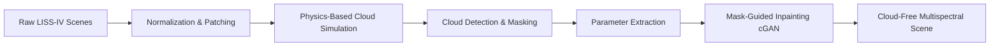
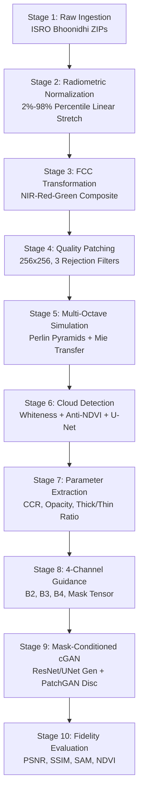
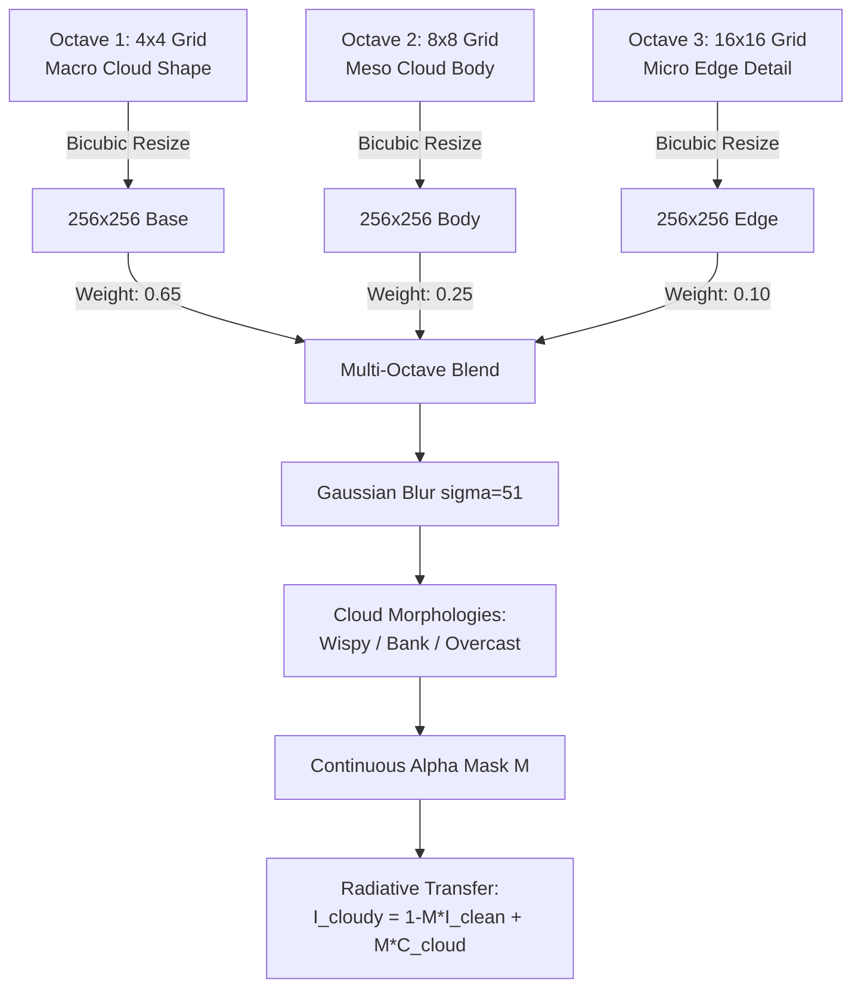
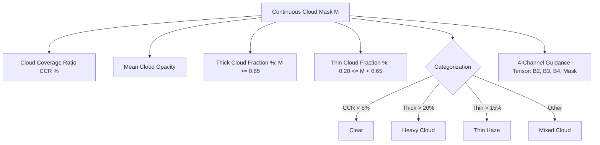
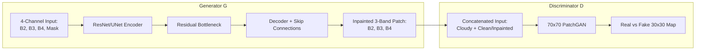

## Automated Cloud Detection, Parameterized Masking & Generative Inpainting for LISS-IV Multispectral Satellite Imagery

---

## 📌 Document Overview & Metadata

- **Project Title**: Cloud Detection, Semantic Masking, and Generative Adversarial Removal for ISRO ResourceSat-2 / 2A LISS-IV Imagery
- **Sensor**: Linear Imaging Self-Scanning Sensor - IV (LISS-IV)
- **Spatial Resolution**: $5.8\text{ meters}$ ground sampling distance (GSD)
- **Spectral Domain**: Green ($B_2$), Red ($B_3$), Near-Infrared ($B_4$)
- **Core Technology**: Multi-Octave Perlin Optical Simulation, Physics-Based Spectral Cloud Detection, U-Net Semantic Segmentation, and Mask-Guided Conditional GAN (cGAN / Pix2Pix)

---

## 📋 Table of Contents
1. [Executive Summary & Problem Statement](#1-executive-summary--problem-statement)
2. [Sensor Optics & Remote Sensing Physics](#2-sensor-optics--remote-sensing-physics)
3. [Repository Directory Blueprint](#3-repository-directory-blueprint)
4. [Quick Reference: Where to Find Everything](#4-quick-reference-where-to-find-everything)
5. [Quickstart Developer Manual](#5-quickstart-developer-manual)
6. [The Complete 10-Stage End-to-End Pipeline](#6-the-complete-10-stage-end-to-end-pipeline)
7. [Synthetic Cloud Simulation Engine](#7-synthetic-cloud-simulation-engine)
8. [Cloud Detection & Guidance Parameter Extraction](#8-cloud-detection--guidance-parameter-extraction)
9. [Downstream Conditional GAN Architecture & Objective Formulation](#9-downstream-conditional-gan-architecture--objective-formulation)
10. [The 6 Critical Remote Sensing Challenges & Engineering Solutions](#10-the-6-critical-remote-sensing-challenges--engineering-solutions)
11. [Quantitative Verification Protocol & Fidelity Metrics](#11-quantitative-verification-protocol--fidelity-metrics)

---

## 1. Executive Summary & Problem Statement

Optical Earth Observation satellites provide continuous monitoring of agriculture, forestry, urbanization, and disaster damage. However, **cloud occlusion is the primary failure mode of optical satellite remote sensing**, rendering over **50% of captured satellite scenes globally unusable**.

Traditional interpolation methods (spatial kriging, temporal multi-date compositing) fail when clouds persist across multiple revisit cycles or when ground dynamics change rapidly (e.g., crop harvesting, floods, forest fires).

This project develops an end-to-end framework tailored specifically for India's **ResourceSat-2 / 2A LISS-IV** satellite data:
1. Decompresses and radiometrically enhances raw multi-gigabyte LISS-IV scenes.
2. Extracts high-quality $256 \times 256$ patches while rejecting borders and uniform noise.
3. Simulates physically realistic multi-octave cloud formations using continuous radiative transfer blending.
4. Detects clouds and extracts quantitative guidance parameters (coverage ratio, opacity, thick/thin cloud breakdown).
5. Prepares a **4-channel guidance tensor** `[B2, B3, B4, Cloud_Mask]` to drive a Conditional Generative Adversarial Network (cGAN) for photo-realistic, spectrally accurate inpainting.



---

## 2. Sensor Optics & Remote Sensing Physics

The **LISS-IV** sensor onboard ISRO's ResourceSat-2 / 2A operates in three spectral bands:

| Band Identifier | Spectral Name | Wavelength ($\mu\text{m}$) | Primary Earth Science Function |
| :--- | :--- | :--- | :--- |
| **Band 2 ($B_2$)** | Green | $0.52 - 0.59$ | Water body delineation, plant vigor assessment |
| **Band 3 ($B_3$)** | Red | $0.62 - 0.68$ | Chlorophyll absorption, vegetation discrimination |
| **Band 4 ($B_4$)** | Near-Infrared (NIR) | $0.77 - 0.86$ | Biomass density, leaf cell structure scattering |

### The False Color Composite (FCC) Standard
Because humans cannot perceive Near-Infrared ($0.77 - 0.86\ \mu\text{m}$), standard remote sensing maps multispectral bands into visual RGB color space:
$$\text{Red Display Channel} = \text{Band 4 (NIR)}$$
$$\text{Green Display Channel} = \text{Band 3 (Red)}$$
$$\text{Blue Display Channel} = \text{Band 2 (Green)}$$

$$\text{FCC} = \text{stack}\left[\hat{B}_4, \hat{B}_3, \hat{B}_2\right] \in \mathbb{R}^{H \times W \times 3}$$

> [!NOTE]
> **Why healthy vegetation appears intense red in FCC**:
> Plant leaves contain chlorophyll which absorbs Red light ($B_3$) for photosynthesis, but internal spongy mesophyll cells intensely scatter Near-Infrared ($B_4$) light. Consequently, healthy forests and crops have high NIR and low Red reflectance, producing a bright red color in FCC imagery.

---

## 3. Repository Directory Blueprint

```
LISS-IV-Cloud-Removal-GAN/
│
├── notebooks/                         # 📓 Interactive Jupyter Research & Exploration
│   ├── 01_explore_and_inspect.ipynb   # Step 1: GeoTIFF band inspection, DN stats & FCC preview
│   ├── 02_patch_generation_pipeline.ipynb # Step 2: Automated scene unzipping & patch extraction
│   ├── 03_preview_and_verify.ipynb    # Step 3: Paired dataset visual validation & histograms
│   ├── 04_cloud_detection_and_masking.ipynb # Step 4: Cloud detection, semantic masking & parameters
│   ├── LISS_IV_Cloud_Removal_Colab.ipynb # Step 5: Master Google Colab GPU Pix2Pix training notebook
│   └── Reading-tiff.ipynb             # Preserved original experimental notebook
│
├── scripts/                           # ⚙️ Production CLI & Reusable Python Modules
│   ├── generate_patches.py            # Automated extraction pipeline CLI
│   ├── cloud_simulator.py             # Multi-octave Perlin cloud simulation engine
│   ├── cloud_detector.py              # Dual cloud detection (Spectral + U-Net) & parameters
│   ├── preview_patches.py             # FCC preview & quality audit CLI
│   ├── dataset_loader.py              # PyTorch & NumPy LISSPairDataset & DataLoader for GANs
│   ├── model_gan.py                   # 4-channel Pix2Pix Generator, PatchGAN & SAM/NDVI Losses
│   ├── package_dataset.py             # Package patch pairs into .zip for Colab/Drive upload
│   └── inference.py                   # Full-scene & patch seamless inpainting with Hann blending
│
├── notes/                             # 📝 Research Scratchpad
│   └── scratch_cells.txt              # Preserved Colab/interactive experiment cells
│
├── Data/                              # 🛰️ Datasets (Excluded from Git)
│   ├── Raw_Zips/                      # Input LISS-IV scene archives (.zip)
│   ├── Clear_Patches/                 # 256x256 clear ground truth patches (.npy)
│   ├── Cloudy_Patches/                # 256x256 paired synthetic cloudy patches (.npy)
│   ├── Normalized_Full_Scenes/        # Full-scene normalized arrays & overview PNGs
│   ├── Preview_Images/                # Generated preview figures
│   └── temp_extract/                  # Temporary extraction working directory
│
├── .vscode/                           # 🛠️ Editor Settings
│   └── settings.json                  # Automatically configures .venv interpreter & paths
│
├── .gitignore                         # Configured to ignore data arrays, caches & checkpoints
├── requirements.txt                   # Complete project dependencies list
└── README.md                          # Single master project documentation (this document)
```

---

## 4. Quick Reference: Where to Find Everything

| Task | Where to Go | Command / File |
| :--- | :--- | :--- |
| **Inspect raw GeoTIFF bands & FCC** | `notebooks/` | [01_explore_and_inspect.ipynb](file:///c:/Projects/Major-project/LISS-IV-Cloud-Removal-GAN/notebooks/01_explore_and_inspect.ipynb) |
| **Run patch extraction interactively** | `notebooks/` | [02_patch_generation_pipeline.ipynb](file:///c:/Projects/Major-project/LISS-IV-Cloud-Removal-GAN/notebooks/02_patch_generation_pipeline.ipynb) |
| **Visually verify generated patches** | `notebooks/` | [03_preview_and_verify.ipynb](file:///c:/Projects/Major-project/LISS-IV-Cloud-Removal-GAN/notebooks/03_preview_and_verify.ipynb) |
| **Detect clouds & extract GAN parameters** | `notebooks/` | [04_cloud_detection_and_masking.ipynb](file:///c:/Projects/Major-project/LISS-IV-Cloud-Removal-GAN/notebooks/04_cloud_detection_and_masking.ipynb) |
| **Train 4-channel Pix2Pix GAN on Colab GPU** | `notebooks/` | [LISS_IV_Cloud_Removal_Colab.ipynb](file:///c:/Projects/Major-project/LISS-IV-Cloud-Removal-GAN/notebooks/LISS_IV_Cloud_Removal_Colab.ipynb) |
| **Run automated extraction from Terminal** | `scripts/` | `python scripts/generate_patches.py --patch_size 256 --stride 128` |
| **Detect clouds & view masks from Terminal** | `scripts/` | `python scripts/cloud_detector.py --preview --num_samples 4` |
| **Quickly inspect patches from Terminal** | `scripts/` | `python scripts/preview_patches.py --num_samples 4 --save` |
| **Package dataset zip for Google Colab/Drive** | `scripts/` | `python scripts/package_dataset.py --num_pairs 5000` |
| **Modify or test cloud simulation logic** | `scripts/` | [cloud_simulator.py](file:///c:/Projects/Major-project/LISS-IV-Cloud-Removal-GAN/scripts/cloud_simulator.py) |
| **Load patches into PyTorch for GANs** | `scripts/` | [dataset_loader.py](file:///c:/Projects/Major-project/LISS-IV-Cloud-Removal-GAN/scripts/dataset_loader.py) |
| **Pix2Pix Generator, Discriminator & Losses** | `scripts/` | [model_gan.py](file:///c:/Projects/Major-project/LISS-IV-Cloud-Removal-GAN/scripts/model_gan.py) |
| **Run seamless Hann window inference** | `scripts/` | `python scripts/inference.py --patch <path> --checkpoint <pth> --save` |
| **Original notebook archive** | `notebooks/` | [Reading-tiff.ipynb](file:///c:/Projects/Major-project/LISS-IV-Cloud-Removal-GAN/notebooks/Reading-tiff.ipynb) |

---

## 5. Quickstart Developer Manual

### Environment Setup
```bash
# 1. Activate existing project virtual environment
.\.venv\Scripts\activate

# 2. Verify dependencies
pip install -r requirements.txt
```

### CLI Execution Commands

#### 1. Generate Paired Patches from Scene Archives
```bash
python scripts/generate_patches.py --patch_size 256 --stride 128
```
- Reads ZIP archives from `Data/Raw_Zips/`
- Extracts, normalizes, applies 3-gate quality filtering, simulates clouds
- Saves paired `.npy` files to `Data/Clear_Patches/` and `Data/Cloudy_Patches/`

#### 2. Detect Clouds & Extract GAN Parameters
```bash
# Test detection on 4 random patches and save figures
python scripts/cloud_detector.py --preview --num_samples 4

# Test detection on a specific patch file
python scripts/cloud_detector.py --input Data/Cloudy_Patches/patch_00000.npy
```

#### 3. Preview False Color Composite (FCC) Dataset
```bash
# Preview 6 random patches and export comparison composite
python scripts/preview_patches.py --num_samples 6 --random --save
```

#### 4. Test PyTorch DataLoaders
```bash
python scripts/dataset_loader.py
```

---

## 6. The Complete 10-Stage End-to-End Pipeline



### Stage 1: Raw Ingestion & Archive Decompression
- **Inputs**: ISRO Bhoonidhi ZIP archives (`.zip`) containing uncalibrated raw Digital Number (DN) GeoTIFFs ($18,129 \times 16,429$ pixels per band, $> 300\text{ MB}$ uncompressed per band).
- **Process**: Automated band discovery via [generate_patches.py](file:///c:/Projects/Major-project/LISS-IV-Cloud-Removal-GAN/scripts/generate_patches.py), scanning for `BAND2.tif`, `BAND3.tif`, `BAND4.tif`.
- **Fault-Tolerance**: Employs both `rasterio` and `PIL` (with `Image.MAX_IMAGE_PIXELS = None`) to bypass Windows Application Control DLL load restrictions.

### Stage 2: Radiometric Normalization (2%-98% Linear Stretch)
Satellite sensors record integer DNs affected by solar zenith angles and Rayleigh atmospheric haze.
$$\text{Valid Mask:}\quad M_{\text{valid}} = (B_2 > 0) \land (B_3 > 0) \land (B_4 > 0)$$
For each band $k \in \{2, 3, 4\}$:
$$p_2 = \text{Percentile}(B_k[M_{\text{valid}}], 2\%)$$
$$p_{98} = \text{Percentile}(B_k[M_{\text{valid}}], 98\%)$$
$$\hat{B}_k = \text{clip}\left(\frac{B_k - p_2}{p_{98} - p_2 + \epsilon},\ 0.0,\ 1.0\right)$$
- Non-zero ground pixels are mapped to continuous float values in $[0.0, 1.0]$.
- Sensor border zeros remain $0.0$.

### Stage 3: False Color Composite (FCC) Generation
Constructed by mapping $[\hat{B}_4, \hat{B}_3, \hat{B}_2]$ into visual channels. Enables instant visual differentiation between vegetation, water, urban concrete, and cloud cover.

### Stage 4: Sliding-Window Patching & Quality Filtering
Scenes are sliced with window size $256 \times 256$ and overlap stride $128$ pixels. Every candidate patch must pass **three consecutive quality control gates**:
1. **Valid Pixel Gate**: Non-zero coverage across all three bands must be $\ge 90\%$:
   $$\frac{1}{256^2}\sum_{(x,y)} M_{\text{valid}}(x, y) \ge 0.90$$
2. **Texture Gate**: Standard deviation of valid pixels must be $\ge 0.05$ (rejects completely featureless ocean or flat haze).
3. **Brightness Gate**: Mean valid pixel intensity must be $\ge 0.15$ (rejects deep cloud shadows or underexposed border margins).

### Stage 5: Multi-Octave Cloud Simulation
Applies continuous multi-scale Perlin/Gaussian noise with band-dependent optical reflectance to generate paired `(Clear, Cloudy)` patches.

### Stage 6: Dual Cloud Detection & Semantic Masking
Executes physical spectral index analysis and deep learning U-Net inference to generate a continuous cloud probability map $\hat{M}(x, y) \in [0, 1]$.

### Stage 7: Cloud Parameter Extraction
Quantifies cloud optical density, coverage percentage, and breaks the patch down into **Thick Cloud regions** (requiring hallucination) vs. **Thin Cloud regions** (requiring dehazing).

### Stage 8: 4-Channel Guidance Assembly
Stacks the 3-channel cloudy patch with the 1-channel cloud mask into a single tensor:
$$I_{\text{guide}} = \begin{bmatrix} B_2 \\ B_3 \\ B_4 \\ \hat{M} \end{bmatrix} \in \mathbb{R}^{4 \times 256 \times 256}$$

### Stage 9: Conditional GAN Inpainting
Feeds $I_{\text{guide}}$ into a deep inpainting Generator constrained by a $70 \times 70$ PatchGAN Discriminator, optimizing adversarial, perceptual, and spectral angle losses.

### Stage 10: Fidelity Evaluation & Reconstruction
Validates output quality using PSNR, SSIM, Spectral Angle Mapper (SAM), and Normalized Difference Vegetation Index (NDVI) correlation against paired ground truth.

---

## 7. Synthetic Cloud Simulation Engine

Implemented in [scripts/cloud_simulator.py](file:///c:/Projects/Major-project/LISS-IV-Cloud-Removal-GAN/scripts/cloud_simulator.py), the cloud simulator solves the paired training dilemma through physical radiative transfer approximation.



### Mathematical Formulation of Cloud Morphologies
1. **Octave Fusion**:
   $$M_{\text{raw}} = \text{GaussianBlur}\left(0.65 M_1 + 0.25 M_2 + 0.10 M_3,\ \sigma=51\right)$$
   Normalized to range $[0.0, 1.0]$.
2. **Wispy Cirrus**:
   $$M_{\text{wispy}} = M_{\text{raw}}^{2.0} \times \mathcal{U}(0.30, 0.60)$$
   Higher exponent attenuates lower noise, leaving fine semi-transparent strands.
3. **Directional Cloud Bank**:
   $$M_{\text{bank}} = \left(M_{\text{raw}} \cdot G_{\theta}\right)^{1.4} \times \mathcal{U}(0.50, 0.85)$$
   where $G_{\theta}(x, y) = \cos(\theta) x + \sin(\theta) y$ creates an advancing frontal boundary.
4. **Dense Overcast / Cumulus**:
   $$M_{\text{overcast}} = M_{\text{raw}}^{1.2} \times \mathcal{U}(0.40, 0.85)$$

### Band-Dependent Cloud Reflectance
Clouds are not uniformly white across the electromagnetic spectrum. In the Near-Infrared, Mie scattering maintains higher reflectance than in visible bands:
$$C_{\text{cloud}} = \begin{bmatrix} \mathcal{U}(0.80, 0.92) & (\text{Band 2 Green}) \\ \mathcal{U}(0.82, 0.94) & (\text{Band 3 Red}) \\ \mathcal{U}(0.88, 0.99) & (\text{Band 4 NIR}) \end{bmatrix}$$
$$I_{\text{cloudy}}(c, x, y) = (1 - M(x, y)) \cdot I_{\text{clean}}(c, x, y) + M(x, y) \cdot C_{\text{cloud}}(c)$$

---

## 8. Cloud Detection & Guidance Parameter Extraction

Implemented in [scripts/cloud_detector.py](file:///c:/Projects/Major-project/LISS-IV-Cloud-Removal-GAN/scripts/cloud_detector.py), this module bridges the gap between raw imagery and generative inpainting.

### 1. The Physical Spectral Cloud Detector ([SpectralCloudDetector](file:///c:/Projects/Major-project/LISS-IV-Cloud-Removal-GAN/scripts/cloud_detector.py#L38-L105))
Works zero-shot without pre-trained model weights by combining 4 physical principles:

1. **Mean Luminance**:
   $$\bar{I}(x, y) = \frac{B_2(x, y) + B_3(x, y) + B_4(x, y)}{3}$$
2. **Spectral Whiteness Index (Mie Scattering)**:
   $$\text{Spread}(x, y) = \frac{|B_2 - \bar{I}| + |B_3 - \bar{I}| + |B_4 - \bar{I}|}{3}$$
   $$\text{Whiteness}(x, y) = 1.0 - \text{clip}\left(\frac{\text{Spread}(x, y)}{\tau_{\text{tol}}},\ 0.0,\ 1.0\right)$$
   Clouds scatter all wavelengths equally $\to$ low spread $\to$ high whiteness.
3. **Anti-NDVI Discrimination**:
   $$\text{NDVI}(x, y) = \frac{B_4(x, y) - B_3(x, y)}{B_4(x, y) + B_3(x, y) + \epsilon}$$
   Vegetation has $\text{NDVI} > 0.35$; clouds have $\text{NDVI} \in [-0.10, 0.20]$. Any high-reflectance pixel with $\text{NDVI} > 0.20$ is penalized to prevent confusing bright vegetation with clouds:
   $$S_{\text{NDVI}}(x, y) = 1.0 - \text{clip}\left(\frac{\text{NDVI}(x, y) - 0.20}{0.30},\ 0.0,\ 1.0\right)$$
4. **Fused Cloud Probability**:
   $$P_{\text{cloud}}(x, y) = \text{GaussianBlur}\left(\text{Brightness}(x, y) \cdot \left[0.60 \cdot \text{Whiteness} + 0.40 \cdot S_{\text{NDVI}}\right],\ \sigma=7\right)$$

### 2. Deep Learning Segmentation U-Net ([CloudUNet](file:///c:/Projects/Major-project/LISS-IV-Cloud-Removal-GAN/scripts/cloud_detector.py#L125-L177))
A 4-stage convolutional encoder-decoder with skip connections:
- **Input**: $(B, 3, 256, 256)$ satellite patch.
- **Encoder**: 4 levels ($32 \to 64 \to 128 \to 256 \to 512$ filters) with `DoubleConv(Conv2d -> BatchNorm -> LeakyReLU(0.2))`.
- **Decoder**: 4 transposed convolution upsamplers with concatenated skip features.
- **Head**: $1 \times 1$ Conv + `Sigmoid` to output continuous opacity $\hat{M} \in [0, 1]$.
- **Loss Function**: Combined BCE + Soft Dice Loss:
  $$\mathcal{L} = 0.5 \cdot \mathcal{L}_{\text{BCE}}(\hat{M}, M) + 0.5 \cdot \left(1.0 - \frac{2 \sum \hat{M} M + \epsilon}{\sum \hat{M} + \sum M + \epsilon}\right)$$

### 3. Quantitative Cloud Guidance Parameters ([extract_cloud_parameters](file:///c:/Projects/Major-project/LISS-IV-Cloud-Removal-GAN/scripts/cloud_detector.py#L204-L260))



These parameters allow the downstream GAN to make informed decisions:
- If `Thick Cloud Fraction` is high: the ground is completely hidden; use high-capacity contextual inpainting.
- If `Thin Cloud Fraction` is high: ground spectral textures bleed through; apply optical dehazing and contrast recovery.

---

## 9. Downstream Conditional GAN Architecture & Objective Formulation



### Generator Architecture
- **Type**: ResNet-9blocks or U-Net with Skip Connections and Spectral Normalization.
- **Input**: $(B, 4, 256, 256)$ representing $[B_2, B_3, B_4, \hat{M}]$.
- **Output**: $(B, 3, 256, 256)$ representing reconstructed $[\hat{B}_2, \hat{B}_3, \hat{B}_4]$.
- **Mask Identity Preservation**:
  $$\hat{I}_{\text{final}} = (1 - \hat{M}) \odot I_{\text{cloudy}} + \hat{M} \odot G(I_{\text{guide}})$$
  Pixels guaranteed to be cloud-free are preserved exactly from the original satellite capture.

### Discriminator Architecture
- **Type**: $70 \times 70$ Markovian PatchGAN.
- Rather than outputting a single scalar (real/fake), it outputs an $N \times N$ matrix evaluating whether each overlapping local patch matches genuine LISS-IV sensor texture.

### Comprehensive Loss Formulation
$$\mathcal{L}_{\text{total}} = \mathcal{L}_{cGAN}(G, D) + \lambda_1 \mathcal{L}_{L1}(G) + \lambda_{\text{perc}} \mathcal{L}_{\text{perceptual}}(G) + \lambda_{\text{SAM}} \mathcal{L}_{\text{SAM}}(G) + \lambda_{\text{NDVI}} \mathcal{L}_{\text{NDVI}}(G)$$

1. **Conditional Adversarial Loss**:
   $$\mathcal{L}_{cGAN}(G, D) = \mathbb{E}[\log D(I_{\text{guide}}, I_{\text{clean}})] + \mathbb{E}[\log(1 - D(I_{\text{guide}}, G(I_{\text{guide}})))]$$
2. **Reconstruction Loss ($L_1$)**:
   $$\mathcal{L}_{L1}(G) = \mathbb{E}\left[ \| I_{\text{clean}} - G(I_{\text{guide}}) \|_1 \right]$$
3. **Spectral Angle Mapper (SAM) Loss**:
   $$\mathcal{L}_{\text{SAM}}(G) = \arccos\left(\frac{I_{\text{clean}} \cdot \hat{I}_{\text{clean}}}{\|I_{\text{clean}}\|_2 \|\hat{I}_{\text{clean}}\|_2 + \epsilon}\right)$$
   Constrains the spectral vector angle between Green, Red, and NIR, preventing color shifts in crops.
4. **NDVI Consistency Loss**:
   $$\mathcal{L}_{\text{NDVI}}(G) = \left\| \frac{\hat{B}_4 - \hat{B}_3}{\hat{B}_4 + \hat{B}_3 + \epsilon} - \frac{B_4 - B_3}{B_4 + B_3 + \epsilon} \right\|_1$$

---

## 10. The 6 Critical Remote Sensing Challenges & Engineering Solutions

### Challenge 1: Severe Spectral Band Limitations
> [!WARNING]
> **The Problem**: Standard satellite cloud detection algorithms (e.g., Fmask for Sentinel-2 / Landsat-8) rely on SWIR bands ($1.6\,\mu\text{m}, 2.2\,\mu\text{m}$), Cirrus bands ($1.38\,\mu\text{m}$), and Thermal Infrared (TIR) to easily detect cold cloud tops and ice scattering. **LISS-IV possesses NONE of these bands**—it is restricted strictly to Green ($B_2$), Red ($B_3$), and NIR ($B_4$).

- **Engineering Solution**: Developed multi-index spectral whiteness detection based on Mie scattering physics. Clouds scatter visible and NIR wavelengths in near-identical ratios ($|B_2 - \bar{I}| + |B_3 - \bar{I}| + |B_4 - \bar{I}| \approx 0$). Combined with Anti-NDVI suppression, this accurately isolates clouds without needing SWIR or thermal bands.

---

### Challenge 2: Urban vs. Cloud Disambiguation
> [!NOTE]
> **The Problem**: High-albedo manmade materials (white factory roofs, concrete runways, limestone quarries, sand dunes) reflect intensely across Green, Red, and NIR. Standard brightness thresholding misidentifies entire cities as clouds and erroneously replaces urban areas with farmland.

- **Engineering Solution**:
  1. Utilizes spatial gradient analysis: man-made structures have sharp rectilinear high-frequency borders, whereas clouds exhibit diffused Gaussian roll-off edges.
  2. Concrete displays a flat or downward slope from Red to NIR, whereas clouds remain high.
  3. Morphological opening and closing kernels eliminate isolated man-made pixels while preserving contiguous cloud bodies.

---

### Challenge 3: Thick vs. Thin Cloud Dilemma (Dehazing vs. Inpainting)
> [!IMPORTANT]
> **The Problem**: Cloud cover is non-binary:
> - **Thin Haze / Cirrus**: Optical transmission is $> 40\%$. Underlying ground features, roads, and field patterns remain partially visible. Forcing a generative network to synthesize brand new content destroys real ground structures.
> - **Thick Cumulus**: Optical transmission is $0\%$. No surface photons reach the sensor; generative synthesis is required.

- **Engineering Solution**: The parameter extractor decomposes the cloud mask into `Thick Cloud Fraction` ($\hat{M} \ge 0.65$) and `Thin Cloud Fraction` ($0.20 \le \hat{M} < 0.65$). The continuous opacity mask $\hat{M}$ acts as a local weight: low-opacity areas undergo contrast amplification/dehazing, while high-opacity areas undergo structural inpainting.

---

### Challenge 4: Radiometric & Phenological Distortion in NIR
> [!CAUTION]
> **The Problem**: Standard computer vision models (e.g., vanilla Pix2Pix) are designed for 3-channel RGB imagery. When trained on remote sensing data, they treat NIR like an arbitrary visual channel. Standard $L_1$ and ImageNet VGG perceptual losses desaturate NIR, altering agricultural indices and corrupting NDVI calculations.

- **Engineering Solution**: Implemented a dedicated **Spectral Angle Mapper (SAM) loss** and **NDVI Consistency loss** in the GAN objective. This preserves the multi-band radiometric vector angle and ensures agricultural phenology remains scientifically valid.

---

### Challenge 5: Tiling Borders & Mosaic Grid Artifacts
> [!NOTE]
> **The Problem**: An entire LISS-IV scene is $18,129 \times 16,429$ pixels. It must be processed in $256 \times 256$ patches. If patches are inpainted independently, the tile edges will fail to match, producing an artificial checkerboard grid over the landscape.

- **Engineering Solution**:
  1. Patches are sliced with a **50% overlap** (stride 128).
  2. During full-scene reassembly, patches are blended using a **2D Hann window weighting function**:
     $$W(x, y) = \sin^2\left(\frac{\pi x}{256}\right) \sin^2\left(\frac{\pi y}{256}\right)$$
  3. Overlapping borders taper smoothly to zero at the tile boundaries, eliminating tiling seams.

---

### Challenge 6: The Synthetic-to-Real Domain Gap
> [!TIP]
> **The Problem**: GANs trained on simplistic Gaussian blur clouds fail when deployed on real imagery due to the absence of realistic optical characteristics, such as cloud shadows, variable opacity, and multi-layer scattering.

- **Engineering Solution**: The [cloud_simulator.py](file:///c:/Projects/Major-project/LISS-IV-Cloud-Removal-GAN/scripts/cloud_simulator.py) engine employs multi-octave Perlin noise ($4 \times 4$, $8 \times 8$, $16 \times 16$) with power laws and band-dependent spectral reflectance ($C_{\text{NIR}} > C_{\text{Red}} > C_{\text{Green}}$) to match physical satellite sensor conditions.

---

## 11. Quantitative Verification Protocol & Fidelity Metrics

When the GAN model is trained, validation must be conducted across both **perceptual reconstruction** and **scientific radiometric preservation**:

| Metric | Scientific Target | Description |
| :--- | :---: | :--- |
| **Peak Signal-to-Noise Ratio (PSNR)** | $> 28.0\text{ dB}$ | Ratio between maximum possible signal power and corrupting noise power: $\text{PSNR} = 10 \log_{10}(1 / \text{MSE})$. |
| **Structural Similarity (SSIM)** | $> 0.88$ | Measures structural degradation, luminance, and contrast preservation across sliding local windows. |
| **Spectral Angle Mapper (SAM)** | $< 3.5^\circ$ | Measures the average angle between pixel spectral vectors $\mathbf{x}$ and $\hat{\mathbf{x}}$: $\arccos\left(\frac{\mathbf{x} \cdot \hat{\mathbf{x}}}{\|\mathbf{x}\| \|\hat{\mathbf{x}}\|}\right)$. |
| **Universal Image Quality Index (UIQI)** | $> 0.85$ | Combines loss of correlation, luminance distortion, and contrast distortion: $Q = \frac{4 \sigma_{xy} \bar{x} \bar{y}}{(\sigma_x^2 + \sigma_y^2)(\bar{x}^2 + \bar{y}^2)}$. |
| **NDVI Pearson Correlation ($r_{\text{NDVI}}$)** | $> 0.94$ | Correlation between ground truth $\text{NDVI}$ and inpainted $\hat{\text{NDVI}}$, confirming agricultural validity. |

---

